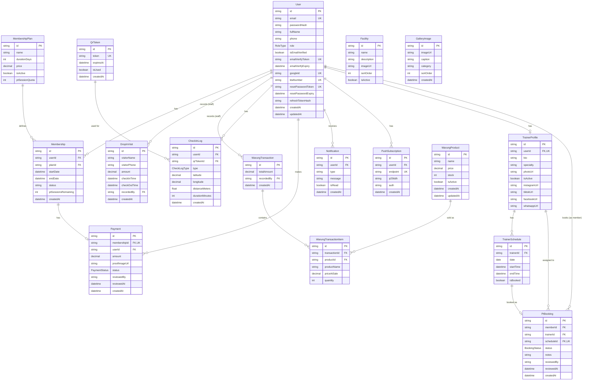

# Ruma Gym: Gym Management System

Ruma Gym adalah sistem manajemen gym full-stack yang menangani seluruh alur operasional sebuah gym modern, mulai dari pendaftaran member dan verifikasi pembayaran, check-in berbasis QR code dengan validasi lokasi real-time, booking sesi personal trainer, hingga pengelolaan kasir warung dan laporan keuangan konsolidasi. Sistem ini dibangun untuk menggantikan proses administratif manual dengan alur digital yang terintegrasi dan dapat diaudit.

## Daftar Isi

- [Ringkasan](#ringkasan)
- [Peran Pengguna](#peran-pengguna)
- [Tech Stack](#tech-stack)
- [Alur Bisnis](#alur-bisnis)
- [Arsitektur Sistem](#arsitektur-sistem)
- [Entity Relationship Diagram](#entity-relationship-diagram)
- [Keamanan](#keamanan)
- [Performa](#performa)
- [Pengujian](#pengujian)
- [Status Proyek](#status-proyek)

## Ringkasan

Aplikasi ini melayani empat peran pengguna dengan dashboard dan hak akses yang berbeda, dengan seluruh alur bisnis — pendaftaran, pembayaran, check-in, booking, hingga laporan keuangan — tercatat dalam satu sistem yang sama. Fokus utama pengembangan adalah konsistensi data pada operasi yang melibatkan lebih dari satu entitas sekaligus, seperti persetujuan pembayaran yang mengaktifkan membership, atau persetujuan booking yang mengurangi kuota sesi personal trainer.

## Peran Pengguna

| Peran | Deskripsi |
|---|---|
| Member | Mendaftar membership, melakukan check-in, booking sesi PT, melihat kartu anggota digital |
| Personal Trainer | Mengelola jadwal ketersediaan, melihat booking yang masuk, mengelola profil publik |
| Admin | Memverifikasi pembayaran, menyetujui booking, mengelola konten, memantau check-in secara real-time |
| Owner | Memiliki seluruh akses Admin ditambah pengelolaan data sensitif seperti perubahan role pengguna |

## Tech Stack

### Backend

- NestJS (TypeScript) dengan arsitektur modular berbasis dependency injection
- Prisma ORM dengan MySQL sebagai basis data relasional
- Passport.js untuk strategi autentikasi JWT dan OAuth 2.0 (Google)
- Socket.io untuk komunikasi real-time dua arah
- BullMQ dengan Redis sebagai message queue untuk background job
- Nodemailer terintegrasi Gmail SMTP untuk pengiriman email transaksional
- Web Push API dengan VAPID untuk notifikasi push browser
- Multer dan Sharp untuk penanganan serta optimasi gambar yang diunggah pengguna
- bcrypt untuk hashing password dan refresh token

### Frontend

- React 19 dengan TypeScript, dibangun di atas Vite
- React Router dengan pola nested routes dan lazy loading per halaman
- Tailwind CSS v4 dengan design system kustom bertema neumorphism
- Socket.io-client untuk sinkronisasi data real-time dengan backend
- Recharts untuk visualisasi data analitik
- html5-qrcode dan qrcode.react untuk pemindaian dan generasi QR code
- jsPDF dengan autoTable untuk generasi laporan PDF di sisi klien

### Infrastruktur

- Reverse proxy nginx untuk terminasi SSL dan pemisahan traffic frontend/backend
- Deployment pada VPS dengan proses backend dikelola melalui process manager

## Alur Bisnis

### Pendaftaran dan Verifikasi Membership

Calon member mendaftar akun dan memverifikasi alamat email sebelum dapat login. Setelah login, member memilih paket membership, mengunggah bukti transfer, lalu menunggu verifikasi manual dari admin. Admin memeriksa bukti pembayaran dan menyetujui atau menolaknya. Persetujuan pembayaran mengaktifkan membership, menetapkan tanggal mulai dan berakhir sesuai durasi paket, serta menerbitkan nomor Kartu Tanda Anggota digital secara otomatis jika member belum memilikinya. Seluruh proses ini dibungkus dalam satu transaksi basis data sehingga tidak ada kondisi di mana pembayaran tercatat disetujui namun membership gagal aktif.

### Check-in Berbasis QR Code

Layar yang terpasang di gym menampilkan QR code statis yang dapat dipindai oleh member melalui aplikasi. Setelah QR code dipindai, sistem memvalidasi data check-in dan memverifikasi lokasi geografis member menggunakan formula Haversine untuk memastikan jarak dari titik gym masih berada dalam radius yang diizinkan. Jika valid, sistem mencatat aksi tersebut sebagai check-in atau check-out berdasarkan status kunjungan member pada hari itu. Sesi yang lupa ditutup akan diselesaikan secara otomatis oleh proses terjadwal.

### Booking Sesi Personal Trainer

Trainer mengatur jadwal ketersediaan mereka sendiri. Member dengan membership aktif dan kuota sesi PT yang tersisa dapat memesan slot yang tersedia. Admin menyetujui atau menolak permintaan booking tersebut. Persetujuan booking mengurangi kuota sesi PT milik member menggunakan operasi pengurangan atomik pada level basis data, sehingga aman terhadap kondisi persaingan apabila beberapa persetujuan diproses hampir bersamaan. Booking yang telah melewati waktu sesinya akan ditandai selesai secara otomatis oleh proses terjadwal.

### Transaksi Warung

Admin mencatat penjualan produk warung melalui antarmuka kasir. Setiap transaksi membekukan harga dan nama produk pada saat transaksi terjadi, sehingga riwayat transaksi tetap akurat meskipun harga produk berubah di kemudian hari. Stok produk berkurang secara atomik untuk mencegah kondisi persaingan pada penjualan yang terjadi bersamaan.

### Laporan Keuangan

Laporan keuangan menggabungkan tiga sumber pendapatan, yaitu pembayaran membership yang telah disetujui, kunjungan drop-in dari pengunjung non-member, dan transaksi warung. Laporan ini dapat diekspor menjadi berkas PDF yang dibuat langsung di sisi klien.

### Pemulihan Akses Akun

Member yang lupa kata sandi dapat meminta tautan reset melalui email. Tautan tersebut berlaku selama satu jam. Setelah kata sandi berhasil diganti, seluruh sesi aktif milik akun tersebut di seluruh perangkat akan diakhiri secara otomatis, sehingga akses yang mungkin diperoleh pihak lain sebelum penggantian kata sandi tidak lagi berlaku.

## Arsitektur Sistem

Backend mengikuti arsitektur modular NestJS dengan pemisahan tegas antara controller, service, dan lapisan akses data. Setiap domain bisnis diisolasi sebagai modul independen dengan dependency yang dideklarasikan secara eksplisit.

Operasi yang melibatkan perubahan pada lebih dari satu tabel sekaligus dibungkus dalam transaksi basis data untuk menjamin atomicity. Contoh operasi semacam ini adalah persetujuan pembayaran yang turut mengaktifkan membership dan menerbitkan nomor KTA, serta persetujuan booking yang turut mengurangi kuota sesi PT.

Komunikasi antar-service yang saling bergantung namun tidak boleh terikat erat diselesaikan menggunakan pola event emitter pada proses bisnis yang membutuhkannya. Sementara itu, mekanisme check-in menggunakan QR code statis sehingga tidak memerlukan WebSocket maupun proses rotasi QR secara real-time.

Autentikasi menggunakan kombinasi access token berumur pendek yang disimpan di memori sisi klien dan refresh token berumur panjang yang disimpan sebagai cookie httpOnly. Sistem menerapkan kebijakan sesi tunggal: hash refresh token disimpan langsung pada baris pengguna di basis data, dan setiap login baru menggantikan hash sebelumnya, sehingga login dari perangkat baru otomatis mengakhiri sesi aktif di perangkat lain.

## Entity Relationship Diagram

## Keamanan

- Autentikasi berbasis JWT dengan kebijakan sesi tunggal, sehingga login baru otomatis mengakhiri sesi aktif sebelumnya
- Refresh token disimpan sebagai cookie httpOnly, tidak dapat diakses melalui JavaScript sisi klien
- Rate limiting pada endpoint autentikasi untuk mencegah upaya brute force dan penyalahgunaan pengiriman email
- Validasi input berlapis menggunakan DTO dan class-validator dengan whitelist otomatis untuk mencegah mass assignment
- Ownership check eksplisit pada setiap operasi yang menyentuh data milik pengguna
- Role-based access control dengan pemisahan wewenang antara Owner dan Admin untuk operasi sensitif
- Security header standar melalui Helmet, termasuk penyesuaian kebijakan resource lintas origin untuk berkas yang diunggah pengguna
- Kompresi dan validasi berkas unggahan untuk mencegah penyalahgunaan endpoint upload

## Performa

- Query analitik menggunakan agregasi pada level basis data alih-alih menarik seluruh data mentah ke aplikasi
- Indeks komposit pada kolom yang sering menjadi filter query, disesuaikan dengan pola akses yang sebenarnya digunakan
- Code splitting per halaman pada frontend sehingga setiap peran pengguna hanya mengunduh kode yang relevan dengan dashboard mereka
- Optimasi gambar otomatis pada saat unggah, dengan parameter kompresi yang disesuaikan dengan kebutuhan masing-masing jenis berkas
- Pembersihan terjadwal untuk data sementara yang tidak perlu disimpan permanen

## Pengujian

Pengujian unit difokuskan pada logika dengan risiko tertinggi apabila terjadi kesalahan, meliputi perhitungan jarak geografis untuk validasi check-in, validasi refresh token pada kebijakan sesi tunggal, transaksi persetujuan pembayaran beserta penerbitan nomor KTA, dan transaksi persetujuan booking beserta pengurangan kuota sesi PT.

## Status Proyek

Aplikasi telah melalui siklus pengembangan penuh mulai dari perencanaan skema basis data, implementasi backend bertahap per modul, pengembangan frontend dengan design system kustom, hingga proses pengerasan keamanan dan optimasi performa menjelang deployment produksi.
